# Portal User Guide

## Navigating the Factory

[https://v1.chainsight.network/factory](https://v1.chainsight.network/factory)

<figure>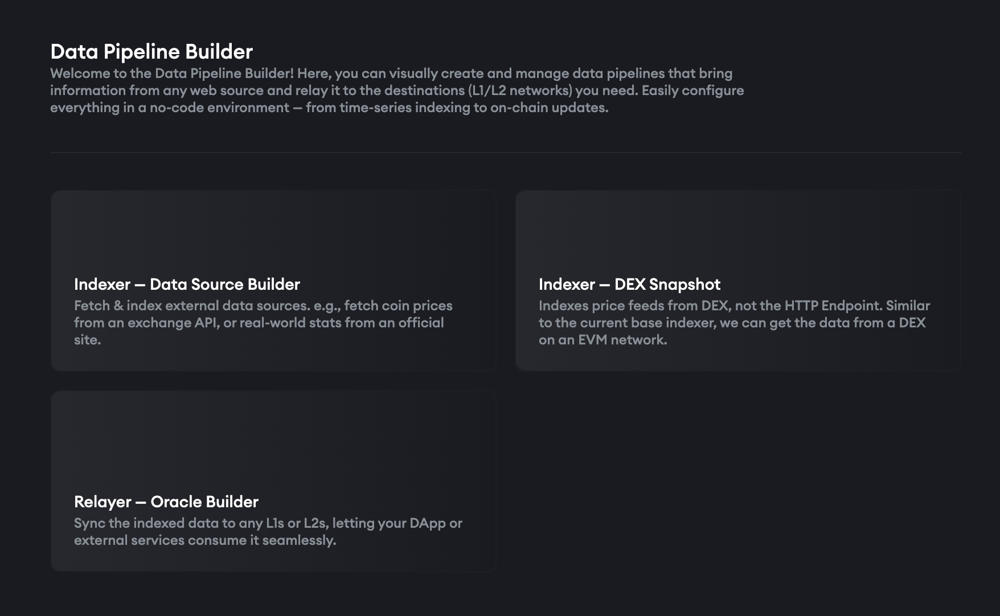<figcaption></figcaption></figure>

## Indexer - Data Source Builder (Web Sources)

<figure>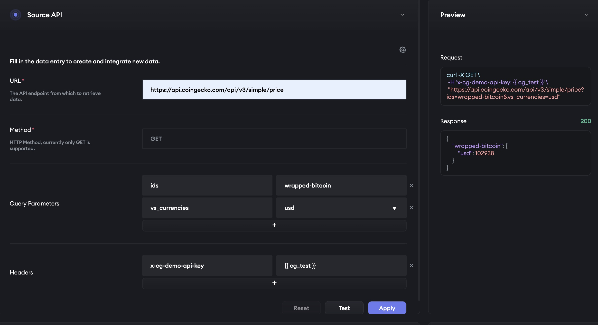<figcaption></figcaption></figure>

#### **Handling Secrets:**

→ Click on the settings wheel in the top right to bring up the secrets model where you can safely store API keys

#### **Path Param:**

→ In the URL field, input whichever endpoint you want to register as a data source.

→ This field can include any endpoint whether it’s a public API, endpoint from your private server, or even serverless functions returning some data

#### **Building the Query:**

→ Fill in the query parameters and headers according to the specification of the source you’re calling from

→ Click **test** to view the output in the side window and **apply** to move to the next step

***

#### **Data Source Entry Details**

→ Select the field from the object (in this case, price in USD)

→ All superficial fields are optional but these help to easily search and identify the data you’ve registered in the global data registry ([https://v1.chainsight.network/explore](https://v1.chainsight.network/explore))

<figure>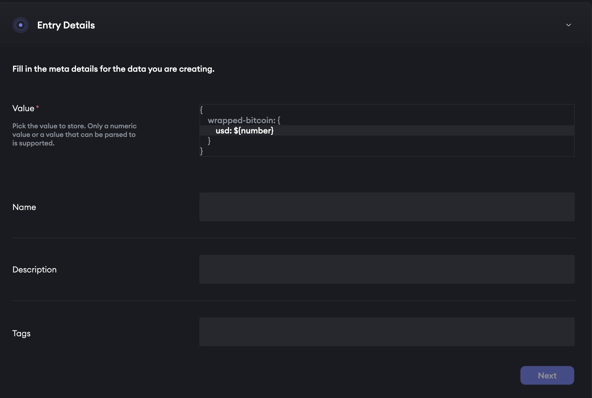<figcaption></figcaption></figure>

***

#### **Frequency Settings**

→ Going with the 60 second retrieval frequency is recommended in 90% of cases, as it not only ensures that your onchain relayer is able to fetch fresh data, it also stores an accurate plot of historical data onchain for 90 days (or more with custom config), allowing you to access and compute on these historical values later on incase you need further insights like volatility.

→ Go for higher timeframes if your use case explicitly requires only infrequent onchain updates (i.e. onchain value updated every week, or strictly every 24hrs with no deviation thresholds)

<figure>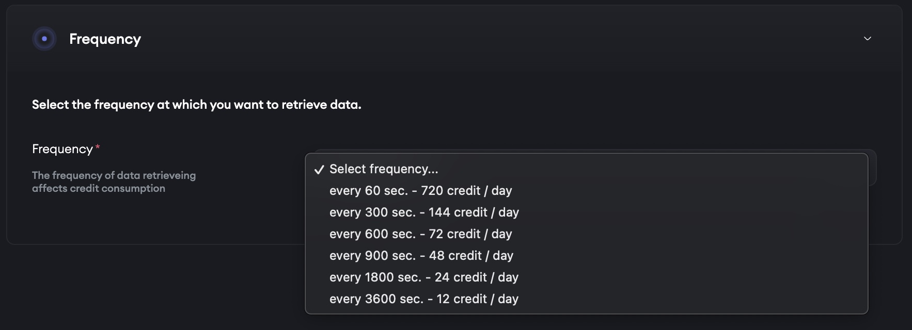<figcaption></figcaption></figure>

***

## Indexer - DEX Snapshot (Onchain Source)

<figure>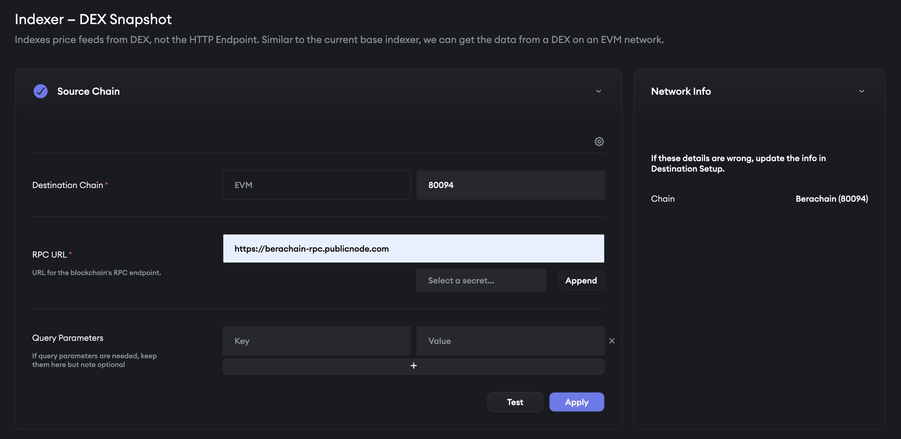<figcaption></figcaption></figure>

#### **Read from Chain**

→ Set the Chain ID and RPC URL of the chain you want to read from

→ If you’re using a private RPC, store the API key securely via the secrets window (click on settings wheel to open)

#### **Read Price from Liquidity Pool/s**

→ Paste the pool address of the asset you want to price

→ The base asset and quote asset can be easily interchanged with the reverse button, with the rate change being reflected on the side window

→ Toggle the combining pairs switch to derive the price of an asset based on several pool combinations


Due to the sensitivity of DEX pools to manipulation, we recommend enabling either the outlier filter or TWAP filter (or both) when publishing DEX-based prices onchain. Contact the team for TWAP configuration as this is currently unavailable through the UI.

_(refer to the Relayer section below)_


<figure>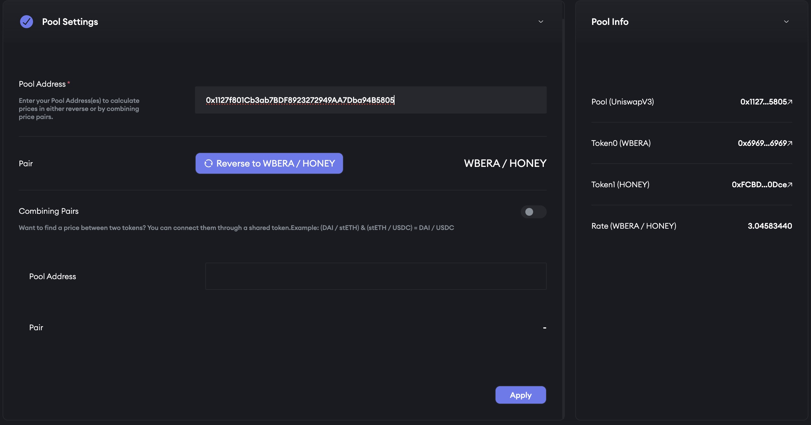<figcaption></figcaption></figure>

***

## Relayer - Oracle Builder (Publish Sources Onchain)

<figure>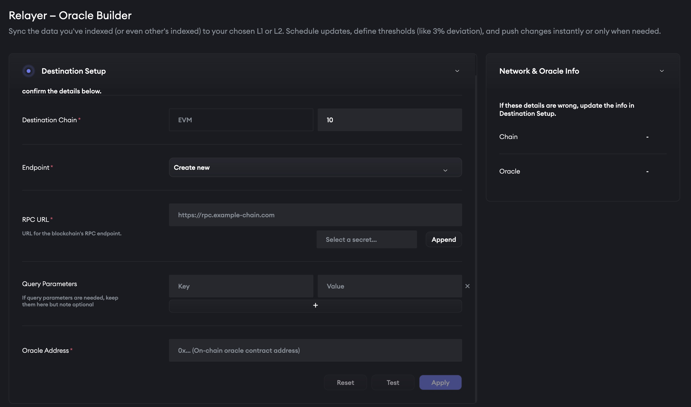<figcaption></figcaption></figure>

#### **Chain ID**

→ Specify the Chain ID or name of the chain you’re pushing to

#### **Endpoint**

→ If the destination chain has been previously configured, you should have a saved RPC endpoint already

→ If not:

1. Click on create new, then paste your RPC URL
2. If you’re using a private RPC, find the settings wheel on this page to store your API key
3. The list of Oracle Addresses for chains actively maintained by the ChainSight team can be found here [https://github.com/horizonx-tech/chainsight-management-oracle](https://github.com/horizonx-tech/chainsight-management-oracle)
4. If the destination chain you’re looking for is not on the list, fill out all the previous fields as normal, click on **test**, then you’ll see a new **“deploy new”** button.
5. When deploying your own instance of ChainSight onto a destination chain, the deployment transaction will sign from the wallet you’ve signed in with or specified. A small amount of gas tokens will be needed in your wallet on the respective chain.

#### **Data Sync**

→ Once configured, you can connect your relayer to any of the data sources available on ChainSight

→ Browse data sources registered by others or filter to find only the ones you’ve set up

<figure>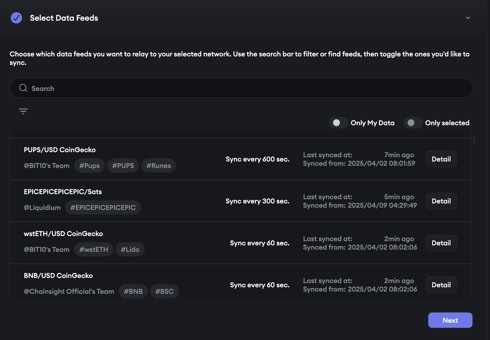<figcaption></figcaption></figure>

#### **Relayer Config Pt. 1: Latency**

→ Heartbeat: Set the default update interval (i.e. “update every 30 minutes no matter what”)

→ Deviation Threshold: Set the threshold of price/value movement to trigger updates (i.e. “update if price goes up or down by 0.5%”)

<figure>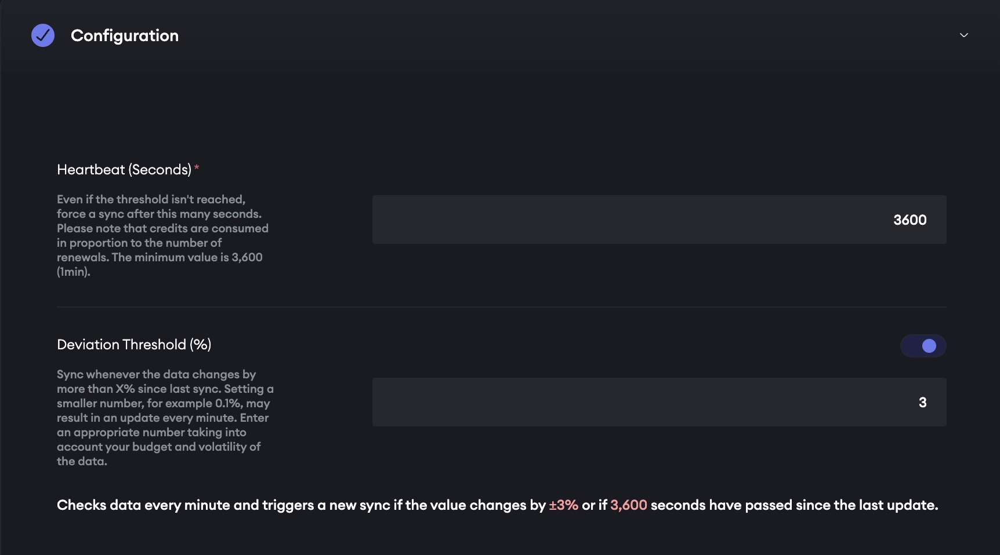<figcaption></figcaption></figure>

#### **Relayer Config Pt. 2: Outlier Filter**

→ A simple toggle to opt in or out of our default outlier filtering logic [https://docs.chainsight.network/chainsight-oracle/relayer#outlier-filter](https://docs.chainsight.network/chainsight-oracle/relayer#outlier-filter)

→ Please reach out to the ChainSight team for support on setting up custom filtering or risk logic for your relayer

<figure>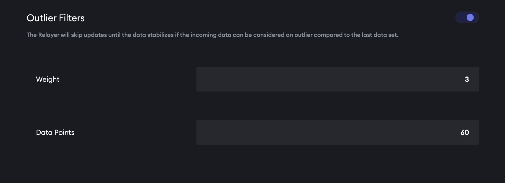<figcaption></figcaption></figure>

***

## Date Pipeline Monitoring and Maintenance

→ To view pipelines you’ve created (data source + relayer) head to [https://v1.chainsight.network/pipeline](https://v1.chainsight.network/pipeline)

#### **Indexer**

<figure>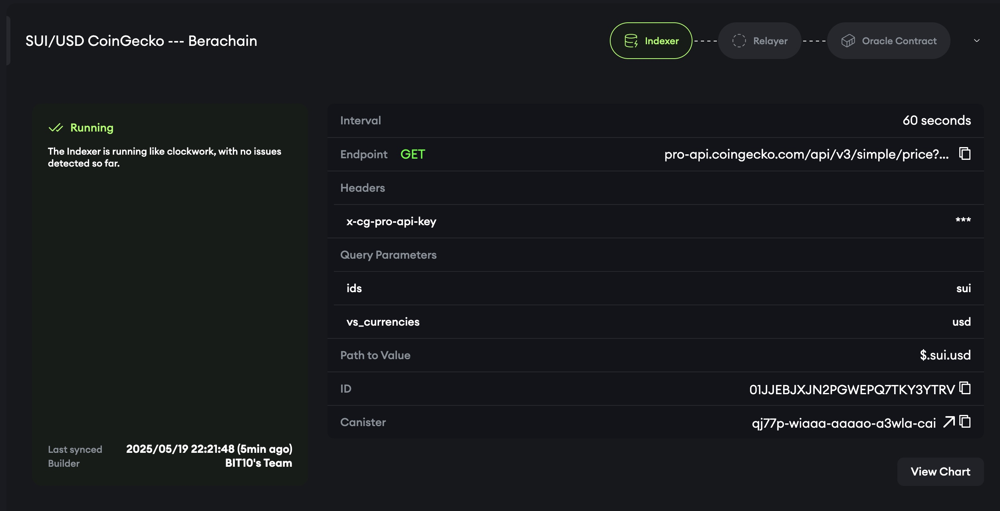<figcaption></figcaption></figure>

→ Check that your Indexer component is green and returning up to date data

→ Pull up the price chart (”View Chart”) to see the historical performance, uptime, and accuracy of your data sources

#### Relayer

<figure>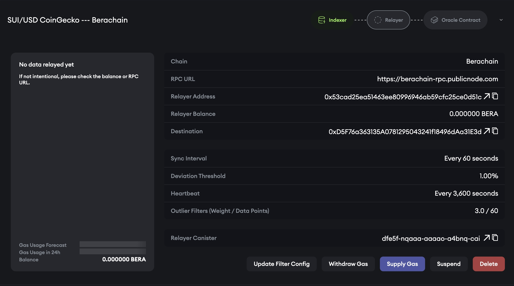<figcaption></figcaption></figure>

→ The relayer address is responsible for writing updates onchain, and thus needs gas to pay the fees

→ Send gas tokens of the respective destination chain to the designated relayer address and monitor the balance/usage from this page

→ Withdraw gas tokens from relayers no longer in use

→ Update Filter Config: Change the latency and toggle on/off the outlier filter (additional config options will be added in future updates)

→ In the event of black swan events or data anomalies, the outlier filter will detect this and pause updates until data normalises. From this page, you can take further action by suspending data relay to the destination chain

***

## Connecting Data to Your Smart Contract

<figure>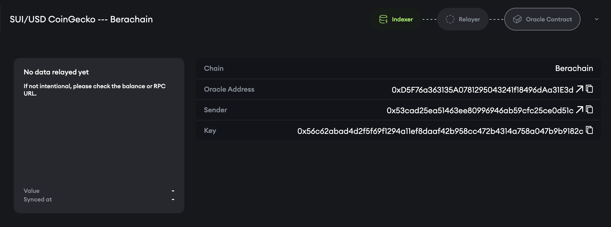<figcaption></figcaption></figure>

→ There are 2 parameters needed to call data using the ChainSight interface, which can be found on the oracle contract section of your pipeline page:

* Sender
* Key

```solidity
// Initiate the interface using the oracle address of your respective destination chain
interface IOracle {
	function readAsUint256WithTimestamp(address sender, bytes32 key)
	    external view
	    returns (uint256, uint64)
	{
	    // Return the uint256 value plus the timestamp
	}
	..//
}
```

→ For further documentation on the oracle contract itself, visit [https://docs.chainsight.network/chainsight-oracle/oracle-contract](https://docs.chainsight.network/chainsight-oracle/oracle-contract)

→ Other data formats supported by the interface [https://github.com/horizonx-tech/chainsight-management-oracle/blob/main/contracts/interfaces/IOracle.sol](https://github.com/horizonx-tech/chainsight-management-oracle/blob/main/contracts/interfaces/IOracle.sol)
